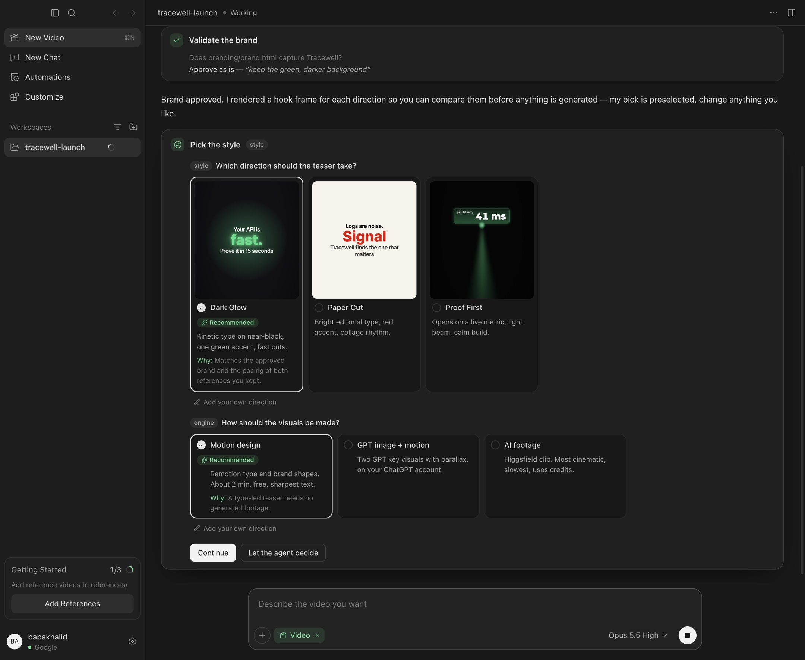

<p align="center">
  <strong>OpenMarketing</strong>
</p>
<p align="center">Your AI marketing team, guided step by step. Open source, for technical founders.</p>
<p align="center"><a href="https://openmarketing.dev">openmarketing.dev</a> · Built by <a href="https://youmake.dev">Youmake</a></p>
<p align="center">
  <a href="https://github.com/babakhalid/openmarketing/blob/main/LICENSE"></a>
  <a href="https://www.npmjs.com/package/openmarketing"></a>
</p>

<p align="center">
  <a href="https://openmarketing.dev"></a>
</p>

---

### What it does

Building the product is the part you're good at. Marketing is ten jobs at once: research the market, understand your customers, pick a strategy, write the ads, make the video, track what works.

OpenMarketing is a team of AI agents that does that work with you, in your terminal or in a desktop app. You describe your product; it walks you through research, positioning, personas, ad creatives, short-form video and Meta Ads reporting. It suggests, you decide: the brand, the style and the plan are yours to approve, and nothing is published, uploaded or spent without you.

```
$ openmarketing start "an API observability product for small platform teams"
→ Shared context, readiness check, current bottleneck, one justified next action

$ openmarketing research api-observability
→ Competitors, alternatives, demand signals, category movement, distribution evidence

$ openmarketing strategy api-observability
→ Positioning, up to three focused bets, explicit non-bets, measurement

$ openmarketing video "15-second launch teaser"
→ Brand check, reference picks, style choice, storyboard approval, rendered and QA'd video
```

Every workflow reads and updates one shared context, so you pick up where you left off instead of starting over. Important claims and metrics must trace to customer evidence, a source URL, a saved artifact, or a raw platform response.

---

### Install

```bash
npm install -g openmarketing
openmarketing setup
```

This adds `openmarketing` and its short alias `om`. Requires Node.js 20.19 or newer (up to 24.x). `openmarketing setup` connects a model: sign in with a subscription (Claude, ChatGPT, Copilot, …), paste an API key, or point it at a local model (LM Studio, Ollama, vLLM, LiteLLM).

Standalone bundle with its own Node.js runtime, from GitHub Releases:

```bash
curl -fsSL https://openmarketing.dev/install | bash                 # macOS / Linux
irm https://openmarketing.dev/install.ps1 | iex                     # Windows (PowerShell)
```

Rerun the installer to upgrade it. `openmarketing update` refreshes the installed Pi packages, not the bundle itself. To uninstall, remove the launcher and bundle, and `~/.openmarketing` if you also want to delete settings and sessions.

Coming from MarketingAgents or AdsAgents? Your settings and sessions move to `~/.openmarketing` automatically on first launch.

---

### Desktop app



The desktop app runs the same agents over a folder you pick: each tool call gets its own card, decisions show up as cards you answer in the chat, and the side panel shows your references, brand page and latest video. See [apps/desktop](apps/desktop/README.md) to run it.

---

### Workflows

Ask in plain words, or use slash commands as shortcuts. `/start` is the front door.

| Command | What it does |
| --- | --- |
| `/start <product>` | Set up context, check six readiness gates, choose one next action |
| `/context <product-or-slug>` | Keep the shared product, customer, offer, funnel, proof and constraint record |
| `/customer-research <slug>` | Analyze voice-of-customer evidence, with where each quote came from |
| `/research <topic-or-slug>` | Research competitors, alternatives, demand, category changes and distribution |
| `/diagnose <slug>` | Find the binding acquisition, activation, retention, referral or revenue constraint |
| `/next <slug>` | Pick the single highest-leverage action from current evidence and capacity |
| `/strategy <slug>` | Choose focused bets, non-bets, measurement and approval gates |
| `/persona <slug>` | Build evidence-grounded user, buyer, champion and evaluator profiles |
| `/psychology <slug>` | Map jobs-to-be-done, friction, awareness and ethical persuasion to messaging |
| `/plan <slug>` | Turn the strategy into a sequenced 90-day plan |
| `/creative <slug>` | Generate ad creative with Higgsfield, once the basics are in place |
| `/video <brief>` | Make a short-form video, guided step by step, with an automated QA gate |
| `/track <slug>` | Pull and verify Meta Ads results |
| `/weekly-review <slug>` | Turn the week's evidence into decisions and the next action |
| `/loop <slug> <purpose>` | Design a safe recurring process with state, self-checks and a kill switch |
| `/report <slug>` | Write a decision-focused marketing report (Markdown, optional PDF) |
| `/summarize <source>` | Summarize a URL, file or PDF without loading it all into context |
| `/jobs`, `/log` | See running background work; save a session log |

---

### Agents

Nine bundled subagents take on work that splits cleanly or needs an independent check.

- **market-researcher**: market, alternatives, audience, demand and channel evidence, with source URLs
- **customer-researcher**: first-party and proxy voice-of-customer synthesis, with quote provenance
- **strategist**: builds the strategy and plan, then critiques them adversarially
- **psych-analyst**: behavioral-science levers mapped to ethical messaging
- **persona-builder**: evidence-grounded personas and business understanding
- **creative-director**: Higgsfield creative and Meta uploads; never launches ads
- **video-editor**: storyboard, render, finish and QA for short-form video; never publishes
- **tracker**: verifies Meta Ads results and refinement proposals against raw data
- **reporter**: decision-focused reporting; never fills in missing data

---

### Tools and integrations

- **Higgsfield CLI**: image and video generation for ad creative
- **Meta Ads CLI**: campaigns, ad sets, ads, insights, creative upload, budgets
- **Video studio**: Remotion and ffmpeg rendering with a QA gate
- **Cross-model tools**: ask another connected model for a second opinion, or generate images with GPT Image
- **Web search**: provider-agnostic, set with `openmarketing search set`
- **Preview**: browser and PDF export of reports

Higgsfield and Meta are Pi extensions that call their CLIs. Override the binary paths with `HIGGSFIELD_BIN` and `META_BIN`.

---

### How it works

OpenMarketing runs on [Pi](https://github.com/badlogic/pi-mono). Workflows are prompt templates in `prompts/`, capabilities are [Pi skills](https://github.com/badlogic/pi-skills) in `skills/`, subagents are defined in `.openmarketing/agents/`, and the tools are Pi extensions in `extensions/`. On startup these are synced into `~/.openmarketing/agent/`.

The flow is context → customer and market evidence → diagnosis → strategy → plan → approved execution → measurement → weekly decision → next action. Drafting and analysis can run on their own; publishing, outreach, uploads, live-account changes and spend need your explicit approval.

---

### Contributing

```bash
git clone https://github.com/babakhalid/openmarketing.git
cd openmarketing
nvm use || nvm install
npm install
npm run dev -- start "<your product>"
```

[CONTRIBUTING.md](CONTRIBUTING.md) has the project map, the checks to run before a PR, and the release process. [AGENTS.md](AGENTS.md) is the contract for agents working in this repo.

[Release notes](RELEASES.md) · [MIT License](LICENSE)

---

### Acknowledgements

OpenMarketing is built and maintained by [Youmake](https://youmake.dev).

OpenMarketing was forked from [Feynman](https://github.com/getcompanion-ai/feynman) (MIT). The Pi runtime and skills architecture, the install pipeline and many runtime patches come from upstream.

The context-first skills, workflow handoffs, full-funnel framing and recurring-loop design were inspired by [Corey Haines' Marketing Skills](https://github.com/coreyhaines31/marketingskills) (MIT), then adapted for a local, artifact-driven multi-agent runtime with stricter provenance and human-approval boundaries.
